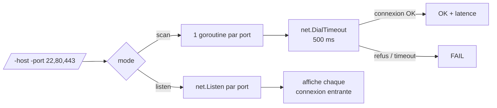
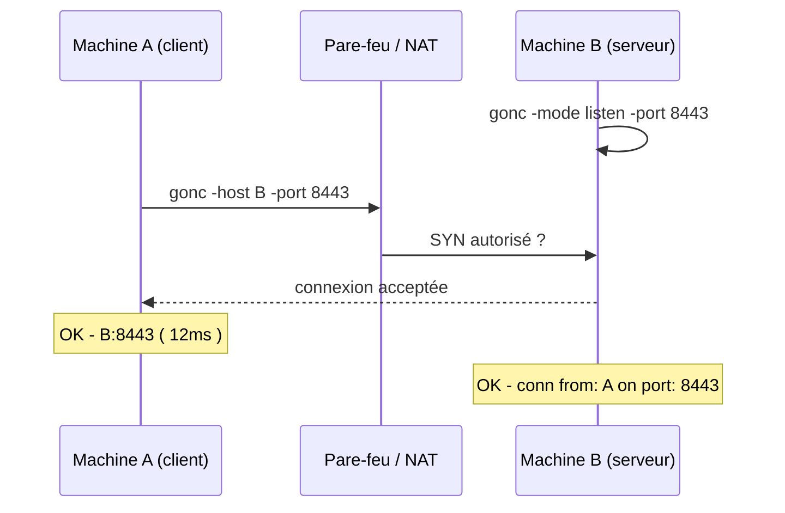

# gonc

**Testeur de ports TCP/UDP en Go : vérifie en parallèle si des ports sont joignables, mesure la latence de connexion, et peut aussi écouter pour tester un flux de bout en bout.**


Un `nc -zv` minimaliste, en un seul binaire sans dépendance : pratique sur un poste Windows ou un serveur où netcat n'est pas installé, pour valider une règle de pare-feu ou un NAT.

---

## Fonctionnalités

- **Scan TCP** de plusieurs ports à la fois, avec la latence de connexion pour chaque port ouvert.
- **Test UDP** : envoie un datagramme et distingue `OK` (réponse reçue) de `OPEN|FILTERED` (pas de réponse, cas normal en UDP).
- **Mode écoute** : ouvre un ou plusieurs ports et affiche chaque connexion entrante. Lancé des deux côtés d'un pare-feu, il prouve qu'un flux passe vraiment.
- **Parallèle** : une goroutine par port ; timeout de 500 ms par tentative, donc un port filtré ne bloque pas le reste.

## Comment ça marche



Tester un flux à travers un pare-feu :



---

## Installation

```bash
git clone https://github.com/LOIC-only-one/gonc.git
cd gonc
go build -o gonc .
```

## Utilisation

```text
gonc -host <cible> -port <p1,p2,...> [-data tcp|udp] [-mode scan|listen]
```

| Option | Défaut | Rôle |
|---|---|---|
| `-host` | `localhost` | Cible à tester (mode scan) |
| `-port` | `8080` | Ports séparés par des virgules |
| `-data` | `tcp` | `tcp` ou `udp` |
| `-mode` | `scan` | `scan` pour tester, `listen` pour écouter |

### Exemples

```console
$ gonc -host example.com -port 22,80,443
OK   - example.com:443 ( 31.8ms )
OK   - example.com:80 ( 32.4ms )
FAIL - example.com:22

$ gonc -host 192.0.2.53 -port 53 -data udp
OPEN|FILTERED - 192.0.2.53:53

$ gonc -mode listen -port 8080,8443
OK - listening on port: 8080
OK - listening on port: 8443
OK - conn from: 192.0.2.20:51234 on port: 8443
```

Les résultats arrivent dans l'ordre où les ports répondent, pas dans l'ordre de la liste.

## Limites

- Le mode écoute ne gère que TCP.
- Le timeout (500 ms) est fixe.
- gonc teste l'ouverture du port, pas le service derrière (pas de lecture de bannière).

---

Projet de [Loïc Maurer](https://github.com/LOIC-only-one) · Réseau & automatisation
